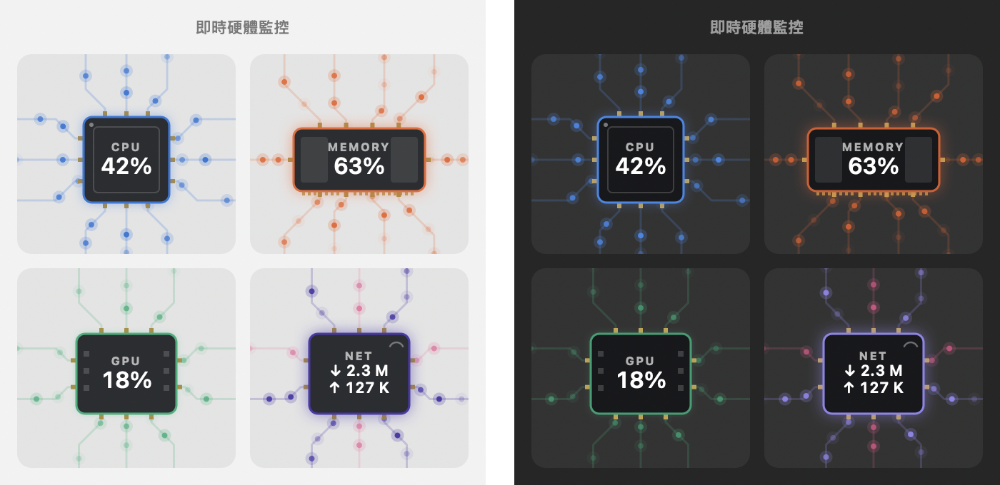

# Computer Monitor

A small macOS menu bar hardware monitor. It shows CPU, memory, GPU, network speed and battery in real time, next to a little animation that runs faster the busier your CPU is. The animation can be a hedgehog, a lemon, or one of your own.



> The app's interface is in Traditional Chinese. Menu names below are given in Chinese with an English translation.

## Features

- **Menu bar**: CPU, memory, GPU, network down/up and battery. Each one can be turned on or off under 在選單列顯示 (Show in menu bar), and values turn orange or red when usage is high.
- **Dropdown panel**: each metric is drawn as a chip with data particles flowing along circuit traces, and the flow speed follows usage. Below it are details such as load average, swap, disk and uptime.
- **Running animation**: the busier the CPU, the faster it runs. There are 10 built-in animations:
  - Hedgehog: classic run, dash & slip, run & fall asleep, roll into a ball, chase the apple
  - Lemon: paper plane ride, umbrella in the rain, snack time, costume change, nap time
- **Custom animations**: drop a GIF or PNG into a folder and it shows up in the menu (see below).
- Adjustable refresh interval (1 / 2 / 5 s) and an option to start at login.
- Lightweight: about 1% CPU and about 15 MB of memory. No network access and no admin rights needed.

Requires macOS 13 or later.

## Build & install

```sh
xcode-select --install     # first time only: Apple's command line tools
./build.sh                 # builds build/ComputerMonitor.app
open build/ComputerMonitor.app
```

An app you build yourself opens without the "unidentified developer" warning. For 登入時自動啟動 (start at login) to work, move the app into your Applications folder first.

`build/ComputerMonitor.app/Contents/MacOS/ComputerMonitor --print` prints one sample of the current values in the terminal.

## Custom animations

Choose 動畫樣式 → 打開自訂動畫資料夾… (Animation style → Open custom animation folder…) from the menu, or open this folder directly:

```
~/Library/Application Support/ComputerMonitor/Animations/
```

Put your animation in it, then open the 動畫樣式 (Animation style) menu again and it will be listed under its file name.

| Format | Example | Frame count |
|---|---|---|
| Animated GIF | `cat.gif` | Read from the file |
| Horizontal PNG strip | `cat@8.png` | The number after `@`; frames are equal width, left to right |
| Folder with one image per frame | `cat/1.png`, `2.png`, … | Number of files, in natural sort order |

- Use a transparent background. Any size works, since frames are scaled to the menu bar height. Aspect ratios from 1:1 to 3:1 look best.
- The playback speed follows CPU usage, so a GIF's own frame timing is ignored. The maximum is 240 frames.

## Project layout

```
Sources/
  main.swift          app, menus, menu bar display
  GraphPanel.swift    chip animation in the dropdown panel
  Metrics.swift       reads CPU / memory / GPU / network / disk / battery
  Hedgehog.swift      loads the running animations and the custom folder
Resources/
  Animations/         built-in animations (<name>@<frames>.png, 36 px tall)
  AppIcon.icns, icon-1024.png
Tools/
  slice-hedgehog.py   cuts the hedgehog sheet into animation strips
  slice-lemon.py      cuts the lemon storyboard (black background) into strips
  make-icon.sh/.swift generates the app icon
Cute Pixel Hedgehog Animation Sheet.png    hedgehog source art (generated with ChatGPT)
Cute Lemon Blob Animation Storyboard.png   lemon source art (generated with ChatGPT)
```

To re-cut the built-in animations (needs Python with pillow, numpy and scipy):

```sh
python3 Tools/slice-hedgehog.py "Cute Pixel Hedgehog Animation Sheet.png" Resources/Animations preview-hedgehog.png
python3 Tools/slice-lemon.py "Cute Lemon Blob Animation Storyboard.png" Resources/Animations preview-lemon.png
```

## Sharing the app

```sh
ditto -c -k --keepParent build/ComputerMonitor.app ComputerMonitor.zip
```

The app is only ad-hoc signed and isn't notarized by Apple, so macOS blocks it the first time someone else opens it. They need to go to System Settings → Privacy & Security and click "Open Anyway". A build made on an Apple silicon Mac won't run on an Intel Mac, so Intel users should build it themselves with `./build.sh`.
